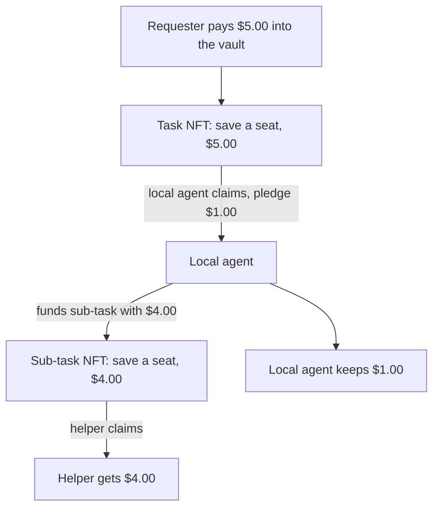
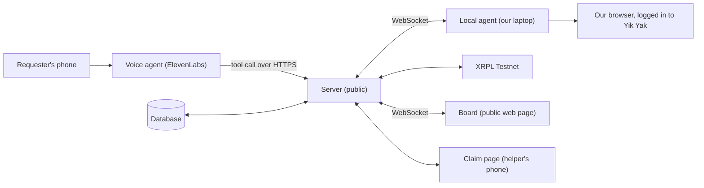
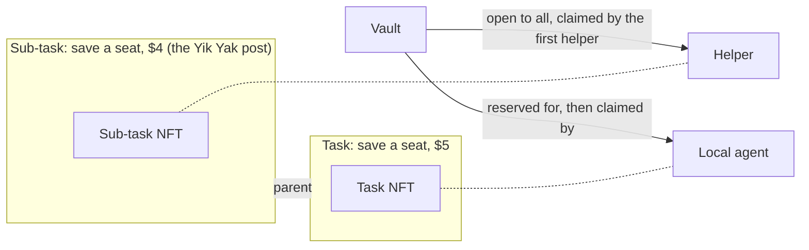

# Agent Pledge

**Call an AI agent with a task. It finds a person to do the task, and the money moves only when the work is done.**

You call a phone number and say: "Save me a seat in Main Stacks in the next 10 minutes. I will pay $5."
The agent posts the job on Yik Yak: "I will pay $4 to the first person who saves a seat in Main Stacks."
A student saves the seat, you give them a PIN, the student gets $4, and the agent keeps $1.

All money moves on the XRP Ledger (XRPL) in RLUSD.
Each task is an NFT, so only one person can do a task at a time.

> Status: hackathon build, October 2026.
> This README is the product requirements document (PRD).
> The base demo comes first. We add other features only after the base demo works.

---

## Contents

1. [Words we use](#1-words-we-use)
2. [The base demo](#2-the-base-demo)
3. [Demo requirements](#3-demo-requirements)
4. [How the parts connect](#4-how-the-parts-connect)
5. [Money and NFT escrow on XRPL](#5-money-and-nft-escrow-on-xrpl)
6. [The voice agent](#6-the-voice-agent)
7. [The local agent](#7-the-local-agent)
8. [The Yik Yak post](#8-the-yik-yak-post)
9. [The board and the claim page](#9-the-board-and-the-claim-page)
10. [Build order](#10-build-order)
11. [Risks](#11-risks)
12. [Features for later](#12-features-for-later)
13. [Tracks](#13-tracks)
14. [Decision log](#14-decision-log)
15. [Run it locally](#15-run-it-locally)

---

## 1. Words we use

We use one word for one thing in this document and in the code.

| Word | Meaning |
|---|---|
| **Requester** | The person who calls and pays for a task. |
| **Voice agent** | The ElevenLabs phone agent. It talks to the requester. |
| **Local agent** | The Agent Pledge AI program. It runs on our laptop and does the work: it makes tasks, claims tasks, and posts on Yik Yak. |
| **Helper** | The person who does the physical work, for example a student who saves the seat. |
| **Task** | A job from the requester, for example "save a seat, $5". |
| **Sub-task** | A smaller job that the local agent gives to a helper, for example "save a seat, $4". |
| **Board** | The public web page that shows all tasks, sub-tasks, and money movements live. |
| **Claim page** | The web page where a helper claims a sub-task and enters the PIN. |
| **Vault** | The XRPL account that holds the money in escrow. |
| **Task NFT** | An XRPL NFT for one task or sub-task. The holder of the NFT has the only right to do the task. |
| **Pledge** | Money that the local agent locks when it claims a task. The requester gets the pledge if the local agent fails. |
| **PIN** | A 4-digit code. The voice agent gives it to the requester. The requester gives it to the helper when they meet. |

## 2. The base demo

This is the full demo, step by step.
Every part of the build supports these steps.

### 2.1 The story

| Step | What happens | What the judges see |
|---|---|---|
| 1 | A judge calls the Agent Pledge phone number. | The call on speaker. |
| 2 | The judge says: "Save me a seat at the front table in the next 3 minutes. I will pay $5." | |
| 3 | The voice agent repeats the task, the time limit, and the price. The judge says "yes". | |
| 4 | The voice agent sends the task to the local agent. The local agent puts the task on the board. | A new task card on the board. |
| 5 | The vault takes $5 from the requester wallet (money escrow). The vault makes the task NFT. | Two ledger transactions on the board, with explorer links. |
| 6 | The voice agent tells the judge the PIN: "Your PIN is 4821." | |
| 7 | The local agent claims the task. It pays a $1 pledge and gets the task NFT in one transaction (NFT escrow). | The task card changes to "claimed". |
| 8 | The local agent makes a sub-task for $4. It pays the $4 into the vault. The vault makes the sub-task NFT. | A money tree: $5 in, $4 to the helper, $1 to the agent. |
| 9 | The local agent writes a Yik Yak post. It opens the browser on our laptop and posts from our Yik Yak account. | The projected laptop: the agent types the post and posts it. |
| 10 | A person in the room sees the post and opens the claim link. They claim the sub-task. | The sub-task card changes to "claimed". |
| 11 | The helper saves a seat and adds a photo. | The photo and "Seat saved: front table, left side" on the board. |
| 12 | The judge walks to the seat and says the PIN. The helper types the PIN on the claim page. | |
| 13 | The vault pays the helper $4. The vault pays the local agent $5 plus its $1 pledge back. | The money tree turns green. Each payment has an explorer link. |
| 14 | The board shows the result: requester has a seat, helper earned $4, agent earned $1. | |

For the 2-minute video, we film the same demo in Main Stacks at a busy time.

### 2.2 The money in the demo



| Who | Pays | Gets | Result |
|---|---|---|---|
| Requester | $5.00 | A seat | Gets the seat |
| Local agent | $1.00 pledge + $4.00 sub-task | $5.00 reward + $1.00 pledge back | +$1.00 |
| Helper | $0.00 | $4.00 | +$4.00 |

### 2.3 If something goes wrong

| Problem | Result |
|---|---|
| No helper claims the sub-task in time. | The vault returns the $5 to the requester. The requester also gets the agent's $1 pledge. The vault returns the $4 sub-task money to the agent. |
| A helper claims the sub-task but does not save a seat (no PIN before the time limit). | The same result as above. The board shows the task as "failed". |
| Two people tap "claim" at the same time. | The XRPL accepts only the first claim. The second person sees "Already claimed". |

We show one failure on the board during the demo, so the judges see that the pledge is real.

## 3. Demo requirements

The demo works only when all of these requirements are true.
Each requirement has a test that we can do before the demo.

| ID | Requirement | Test |
|---|---|---|
| R1 | **Voice agent.** A person can call a phone number. The voice agent gets the task, the place, the time limit, and the price. It confirms them aloud and tells the caller the PIN. | Call the number. Make a task. Hear the PIN. |
| R2 | **Local agent.** An AI agent runs on our laptop. It receives the task from the voice agent and makes the task, the claim, and the sub-task without a person. | Make a call with no person at the laptop. The sub-task appears on the board. |
| R3 | **Board online.** A public URL shows all tasks, sub-tasks, NFTs, payments, and the money tree. It updates in less than 2 seconds after each change. | Open the board on a phone. Make a task. See it appear. |
| R4 | **Money escrow.** The requester's money goes into the vault before work starts. The vault pays out only after the PIN is correct. The vault returns the money if the task fails. | Do one success and one failure. Check every payment on the XRPL testnet explorer. |
| R5 | **NFT escrow.** Each task and sub-task is an NFT. A claim gives the NFT to one claimer only. The payout swaps the NFT for the money in one transaction. | Tap "claim" on two phones at the same time. Only one claim succeeds. |
| R6 | **Yik Yak post.** The local agent posts the sub-task on Yik Yak from our logged-in browser on our laptop. It saves a screenshot of the post. | Make a task. See the post on Yik Yak on a phone. See the screenshot on the board. |
| R7 | **Claim page.** A helper can open the link from the Yik Yak post, claim the sub-task, add a photo, and enter the PIN. The helper does not need a crypto wallet. | Do the full claim on a phone that has never used Agent Pledge. |
| R8 | **PIN proof.** The vault pays only when the PIN is correct. Three wrong PINs lock the sub-task. | Enter a wrong PIN. No payment. Enter the correct PIN. Payment. |
| R9 | **Nothing hard-coded.** The task text, the place, the price, the time limit, and the Yik Yak post come from the call. They are not fixed in the code. | Make two calls with different tasks and prices. Both work. |

## 4. How the parts connect



- The **server** is public. It receives tool calls from the voice agent, sends ledger transactions, and sends live updates to the board.
- The **local agent** connects to the server with an outgoing WebSocket. Thus, our laptop does not need a public address.
- The **server** sends each voice-agent tool call to the local agent. The local agent decides what to do and calls the server API.
- Only the server holds the vault key. The local agent holds its own wallet key.

Recommended stack:

| Part | Stack |
|---|---|
| Server | Node.js, TypeScript, Fastify, `ws`, xrpl.js |
| Database | Postgres (SQLite for local development) |
| Board and claim page | Next.js |
| Voice agent | ElevenLabs Agents with a phone number (Twilio) and server tools |
| Local agent | TypeScript with the Claude Agent SDK |
| Yik Yak post | A browser agent on our laptop (Claude in Chrome, or Playwright with our Chrome profile) |
| Hosting | Server and board on one public host (for example Fly.io or Render) |

## 5. Money and NFT escrow on XRPL

### 5.1 Network and money

- Network: XRPL Testnet (`wss://s.altnet.rippletest.net:51233`).
- Money: RLUSD. Testnet issuer: `rQhWct2fv4Vc4KRjRgMrxa8xPN9Zx9iLKV`. Currency code: `524C555344000000000000000000000000000000`.
- Each wallet (requester, local agent, helper, vault) has a trust line to RLUSD.
- The server makes wallets for the requester and for each helper. Thus, the requester and the helper do not need a crypto wallet.

### 5.2 Why the vault holds the money

XRPL has native escrow for tokens (the Token Escrow amendment, XLS-85).
But the token issuer must allow it with the `allowTrustLineLocking` flag.
On 2026-10-11, the RLUSD issuer has this flag **off** on testnet and on mainnet. We checked with `account_info`.
Thus, we cannot put RLUSD in native escrow.

Our solution:

- The vault account holds the money for each task.
- Each vault transaction has a memo with the task ID. Anyone can audit the full history on the XRPL explorer.
- The claim and the payout are NFT swaps. The XRPL makes each swap complete fully or not at all.
- If the RLUSD issuer sets `allowTrustLineLocking` later, we can move each task's money into native escrow.

### 5.3 One NFT for each task and each sub-task

This is the main idea of the NFT escrow.

Each task and each sub-task has its own NFT.
Each NFT has one holder: the agent or person who does that task.
An NFT never goes from the local agent to the helper, or from the helper to the local agent.

In the demo, there are two NFTs:

| NFT | Made when | Reserved for | Shows that |
|---|---|---|---|
| **Task NFT** ("save a seat, $5") | The requester calls and pays $5. | The local agent | The local agent has the only right to do the $5 task, and the right to the $5 payout. |
| **Sub-task NFT** ("save a seat, $4") | The local agent posts the $4 job on Yik Yak. | The helper who claims first | The helper has the only right to do the $4 sub-task, and the right to the $4 payout. |

Each Yik Yak post links to one sub-task, and each sub-task has one NFT.
If the local agent posts a second time for the same task, it makes a new sub-task with a new NFT.



How an NFT reserves a task:

1. The vault makes the NFT when the task is made. The vault holds it, so nobody has the task yet.
2. The vault makes a sell offer for the NFT.
   For the task NFT, the offer is only for the local agent (`Destination`).
   For the sub-task NFT, the offer is open, and the first helper to accept it gets it.
3. The claimer accepts the offer. Now the claimer holds the NFT, and the task is reserved for that claimer.
   The XRPL lets only one account accept an offer. Thus, two claimers cannot both get the task.
4. When the work is done, the holder swaps the NFT back to the vault for the payout, in one transaction.
5. The vault burns the NFT. The task is closed.

The sub-task NFT has the task NFT ID in its data (its `URI` points to data with a `parent_nft_id` field).
Thus, the board can draw the money tree from the NFTs, and anyone can audit which task paid for which sub-task.

### 5.4 Ledger transactions in the demo

The vault makes each task NFT with the flags `tfBurnable` and `tfTransferable`.
The NFT `URI` points to the task data on the server.

| Demo step | Transaction | Result |
|---|---|---|
| 5. Money escrow | `Payment` requester to vault, 5 RLUSD | The vault holds the requester's money. |
| 5. Task NFT | `NFTokenMint` by the vault | The task NFT exists. The vault owns it. |
| 7. Offer | `NFTokenCreateOffer` by the vault: sell, `Amount` = 1 RLUSD (the pledge), `Destination` = local agent | Only the local agent can take the task. |
| 7. Claim | `NFTokenAcceptOffer` by the local agent | In one transaction, the local agent pays the pledge and gets the task NFT. |
| 8. Sub-task money | `Payment` local agent to vault, 4 RLUSD | The vault holds the helper's money. |
| 8. Sub-task NFT | `NFTokenMint` by the vault, then `NFTokenCreateOffer`: sell, `Amount` = 0, no `Destination` | Any helper can claim the sub-task. |
| 10. Helper claim | `NFTokenAcceptOffer` by the helper wallet | The helper gets the sub-task NFT. A second claim fails because the offer no longer exists. |
| 13. Helper payout | Helper `NFTokenCreateOffer`: sell, `Amount` = 4 RLUSD, `Destination` = vault. Then `NFTokenAcceptOffer` by the vault. | In one transaction, the NFT goes back to the vault and the helper gets $4. |
| 13. Agent payout | The same swap for the task NFT, `Amount` = 6 RLUSD ($5 reward + $1 pledge) | The local agent gets $6. |
| 13. Close | `NFTokenBurn` by the vault, for both NFTs | The tasks are closed. |
| Failure | `NFTokenBurn` by the vault, then `Payment` vault to requester (5 + 1 RLUSD) and vault to local agent (4 RLUSD) | The requester gets the money back plus the pledge. |

The server signs helper transactions with the helper wallet that it made for the helper.

> **Caution:** Make sure that the XRPL accepts a sell offer with `Amount` = 0 and no `Destination` (step 8).
> Test it on testnet before you build other parts.
> If the XRPL rejects it, set `Amount` to 1 drop of XRP. Each helper wallet gets XRP from the testnet faucet.

## 6. The voice agent

We use ElevenLabs Agents with a phone number.

The voice agent must:

1. Answer the call and ask what the caller needs.
2. Get four values: the task, the place, the time limit, and the maximum price.
3. Repeat the four values and get a "yes".
4. Call the `create_task` tool on the server.
5. Read the PIN from the tool result and say it to the caller two times.
6. Tell the caller the board URL, where they can see the task.

The voice agent must not:

- Make up a price. If the caller does not give a price, it asks for one.
- Accept a task that is not a seat hold in the base demo. It says: "Right now I can only save seats."

Server tools:

| Tool | Input | Output |
|---|---|---|
| `create_task` | `description, place, time_limit_minutes, price_usd, caller_phone` | `task_id, pin, board_url` |
| `task_status` | `task_id` | `status, helper_note` |

## 7. The local agent

The local agent is a TypeScript program on our laptop.
It uses the Claude Agent SDK.
It receives each task from the server and does all the work without a person.

### 7.1 What it does for each task

1. Receive the task from the server.
2. Claim the task: accept the NFT offer and pay the pledge.
3. Decide the sub-task price. In the base demo, the sub-task price is 80% of the task price, rounded down to $0.50.
4. Make the sub-task and pay its money into the vault.
5. Write a short Yik Yak post with the place, the time limit, the price, and the claim link.
6. Post it on Yik Yak with the browser agent (see [section 8](#8-the-yik-yak-post)).
7. Watch the sub-task. When the helper enters the correct PIN, redeem the task NFT for the payout.

### 7.2 Tools that the local agent has

| Tool | What it does |
|---|---|
| `claim_task` | Accepts the vault's NFT offer for a task. |
| `create_subtask` | Pays the sub-task money to the vault and makes the sub-task. |
| `post_yikyak` | Gives a post to the browser agent. Returns a screenshot of the post. |
| `get_task` | Reads the status of a task or a sub-task. |
| `redeem_task` | Swaps a completed task NFT for the payout. |

### 7.3 Example Yik Yak post

> $4 to save a seat at the front table in the next 3 min. First to claim gets it: <board-url>/c/7Q2K

The local agent writes each post from the task data.
The post is not fixed in the code.

## 8. The Yik Yak post

Yik Yak does not have a public API for posts, and Yik Yak does not permit bots.
For this demo, the local agent posts from our own Yik Yak account.
It uses our browser on our laptop, where we are already logged in.

How the post works:

1. The local agent calls `post_yikyak` with the post text.
2. The browser agent opens Yik Yak in our logged-in browser.
3. The browser agent writes the post and posts it.
4. The browser agent takes a screenshot of the post.
5. The local agent sends the screenshot to the server. The board shows it.

Rules for the post:

- Post at most one post each 10 minutes, so that Yik Yak does not block the account.
- Keep our laptop near the venue. Yik Yak shows posts by location.
- Show the laptop on the projector during the demo, so that the judges see the post live.

> **Caution:** Make sure that Yik Yak works in our desktop browser on day one.
> The only Yik Yak website that we found is from 2016.
> If there is no website, use the Yik Yak iPhone app on an Apple silicon Mac, and use a computer-use agent in place of the browser agent.

## 9. The board and the claim page

### 9.1 The board

The board is the main screen of the demo.
It must show:

- Each task and sub-task as a card, with its status: open, claimed, done, or failed.
- The money tree for each task, with the amount on each line.
- An explorer link for each ledger transaction.
- The Yik Yak screenshot and the helper's seat photo.
- A short log of the local agent's decisions, for example "Sub-task price: $4.00 (80% of $5.00)".

The board must update in less than 2 seconds after each change.
It must be easy to read from the back of the room.

### 9.2 The claim page

The helper opens the claim page from the link in the Yik Yak post.
The claim page must:

1. Show the sub-task: the place, the time limit, and the pay.
2. Show one "Claim" button.
3. Make a wallet for the helper when the helper taps "Claim". The helper does not see the wallet.
4. Show "Already claimed" if another person claimed first.
5. Let the helper add a photo and a short note, for example "Front table, left side".
6. Let the helper enter the PIN.
7. Show "Paid $4.00" with an explorer link after the payout.

The claim page must work well on a phone.

## 10. Build order

Build in this order.
Each part depends on the part before it.

| # | Part | Done when |
|---|---|---|
| 1 | XRPL ledger module | A script does the full success flow and the full failure flow from [section 5.4](#54-ledger-transactions-in-the-demo) on testnet. |
| 2 | Server and database | The server API makes tasks, claims, sub-tasks, and payouts. It sends live updates. |
| 3 | Board | The board shows the flow from part 1 live, with explorer links. |
| 4 | Claim page | A helper can claim, add a photo, and enter the PIN from a phone. |
| 5 | Local agent | The local agent claims a task and makes a sub-task without a person. |
| 6 | Yik Yak post | The local agent posts on Yik Yak and the screenshot shows on the board. |
| 7 | Voice agent | A phone call makes a task and the caller hears the PIN. |
| 8 | Full rehearsal | Two full demos in a row, one success and one failure, with no person at the laptop. |
| 9 | Video | We film the demo in Main Stacks. |

Do these tasks first, because they can block the build:

- Get testnet RLUSD. Ask the Ripple team at their table.
- Make sure that Yik Yak works in our desktop browser.
- Get the ElevenLabs phone number.

## 11. Risks

| Risk | What we do |
|---|---|
| We cannot get testnet RLUSD. | Make our own test token from a team account. If we set `allowTrustLineLocking` on that account, we can also show native Token Escrow. |
| Yik Yak does not work in a desktop browser. | Use the Yik Yak iPhone app on an Apple silicon Mac with a computer-use agent. |
| Yik Yak blocks the account. | Post at most one post each 10 minutes. Keep a recording of a post as a backup for the demo. |
| Nobody in the room claims the sub-task. | Ask the room to watch Yik Yak before the demo. The failure flow also shows the pledge, so the demo still works. |
| XRPL testnet is slow (about 4 seconds for each ledger). | Send independent transactions at the same time. Show "pending" on the board. |
| The phone call fails. | Keep a web form on the board that sends the same `create_task` call. |

## 12. Features for later

We add these features only after the base demo works.
Each feature has a short description.

- **Competing agents.** Many agents bid on each task. The lowest price wins among agents that pay the required pledge.
- **Agents from other people.** Developers connect their own agents to the server and earn money.
- **Public profit and loss.** A page for each agent with its earnings, costs, and lost pledges, from ledger data.
- **Price learning.** The local agent sets the sub-task price from past results, and increases it when no helper claims.
- **Food delivery.** The local agent calls a restaurant with an ElevenLabs voice and orders food. A helper picks it up, pays, and gets the food cost plus a fee. Context.dev gives restaurant and menu prices.
- **Bug fixes.** A requester gives a repository and a failing command. An agent sends a patch. A verifier runs the command again. The vault pays when the command passes.
- **Sub-task chains.** An agent gives a task to another agent, which gives a sub-task to a helper.
- **More places to post.** Discord, SMS, and push messages to helpers near the task.
- **Helper pledges.** Helpers also lock a small pledge when they claim.
- **Vault security.** The vault uses a multi-signature `SignerList` and a disabled master key.
- **Helper credentials.** The platform gives an XRPL Credential to verified helpers.

## 13. Tracks

We enter one general track and three sponsor tracks.

| Track | Why Agent Pledge fits |
|---|---|
| **Most Creative** (general) | An AI agent hires a person. The agent is the contractor, and the person is the subcontractor. |
| **Best Use of Ripple** | RLUSD payments, task NFTs for the claim lock and the payout swap, and memos for a public audit trail, all in one product. |
| **YZi Labs** | The local agent has its own wallet, locks a pledge before it works, and each payment is on the ledger. A person gives the task by voice. |
| **Best Use of ElevenLabs** (bonus) | The voice agent takes the task on a phone call, confirms it, and says the PIN. |

YZi Labs accepts any chain, but its setup steps use BSC Testnet.
Ask at the YZi Labs table if they judge an XRPL project the same.

We enter Context.dev only if we build food delivery (see [section 12](#12-features-for-later)).

## 14. Decision log

| Date | Decision | Reason |
|---|---|---|
| 2026-10-11 | We use XRPL and RLUSD for money. | XRPL NFTs give a claim lock and a payout swap with no smart contract. This is for the Ripple track. |
| 2026-10-11 | The vault holds the money, not native escrow. | The RLUSD issuer has `allowTrustLineLocking` off on testnet and on mainnet. |
| 2026-10-11 | The base demo is the seat hold only. | It is fast, it is real, and it shows the full idea: a person calls, an agent hires a person, and the money moves on proof. |
| 2026-10-11 | The local agent runs on our laptop and posts on Yik Yak from our logged-in browser. | Yik Yak has no public API for posts. Our own browser session makes the post real and visible to the judges. |
| 2026-10-11 | The proof is a PIN from the requester to the helper. | It is simple, and the helper cannot fake it. |
| 2026-10-11 | Other features wait until the base demo works. | A small demo that works is better than a large demo that does not work. |
| 2026-10-11 | Our general track is Most Creative. | The main idea is creative: an AI agent hires a person. |
| 2026-10-11 | We also enter the YZi Labs track. | It accepts any chain. It asks for agents with wallets that people can trust, and for voice-first agents. |
| 2026-10-11 | Database: Drizzle ORM with the Postgres dialect everywhere. node-postgres in production; PGlite (embedded Postgres in WASM) for local development and tests. This replaces "SQLite for local development". | Two SQL dialects would need two schemas. One schema and one migration folder run on every host, and tests need no database server. Drizzle is light and type-safe, with plain SQL migrations. |
| 2026-10-11 | Media bytes (photos, Yik Yak screenshots) live in Postgres (`bytea`). | Works on any host and in PGlite, with no volume or bucket to set up. |
| 2026-10-11 | The local agent signs its own transactions on the laptop (claim, sub-task funding, redeem offer) and sends the hash; the server verifies it with `verifyTx` and does the vault steps. | The server never holds the agent's key (PRD 4). With `LEDGER_MODE=fake` the server can do the agent's step, so the flow is testable without XRPL. See `docs/api.md`. |

## 15. Run it locally

Needs Node 22+ and pnpm 10. The API contract is in [`docs/api.md`](docs/api.md).

```sh
pnpm install
cp apps/server/.env.example apps/server/.env   # optional: every value has a dev default
pnpm db:seed      # one demo task per status (stop `pnpm dev` first: PGlite allows one process)
pnpm dev          # server on http://localhost:3001 (GET /health), fake ledger, PGlite in apps/server/.data
pnpm lint && pnpm typecheck && pnpm test
pnpm db:reset     # wipe the database before a rehearsal
```

- `LEDGER_MODE=fake` (default) uses an in-memory ledger. `LEDGER_MODE=xrpl` uses `packages/ledger` on XRPL testnet.
- Set `DATABASE_URL=postgres://…` to use real Postgres. Migrations run at startup.
- Docker: `docker build -f apps/server/Dockerfile -t agent-pledge-server .` from the repo root.
